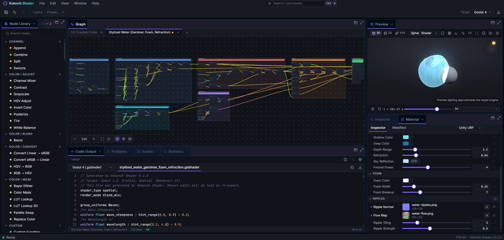

<div align="center">

# ⬡ Kekenik Shader

**A browser-based, engine-independent, node-based shader editor.**  
Build **one** shader graph in your browser and export it to **GLSL (WebGL2)**, **WGSL (WebGPU)**, **HLSL**, **Unity URP**, and **Godot 4.x**.

[](LICENSE)
[](CHANGELOG.md)
[](https://github.com/adam1442/kekenik-shader/actions/workflows/deploy.yml)

[**Live Demo**](https://adam1442.github.io/kekenik-shader/) · [**Documentation**](docs/USER_GUIDE.md) · [**Architecture**](docs/ARCHITECTURE.md) · [**Export Targets**](docs/EXPORT_TARGETS.md) · [**فارسی (Persian README)**](README.fa.md)

</div>



> **Early Preview (`v0.1.0`) Notice:** Kekenik Shader is in active early preview. While the core graph compiler, IR optimizer, WebGL2 preview, and multi-target exporters are functional, many features still need more work, and Unity URP / Godot 4 exports have not yet been verified across all engine versions. Known issues and experimental areas are documented honestly below and in [`docs/KNOWN_ISSUES.md`](docs/KNOWN_ISSUES.md).

---

## Live Demo

Try Kekenik Shader directly in your browser (no installation or account required):

👉 **[https://adam1442.github.io/kekenik-shader/](https://adam1442.github.io/kekenik-shader/)**

Everything runs 100% client-side in your browser. There is no telemetry, analytics, or server backend.

---

## Why Kekenik Shader?

Game developers and technical artists frequently work across engines or migrate projects between **Unity URP**, **Godot 4**, and custom **WebGL2 / WebGPU / Direct3D** renderers. Authoring the same shader graph twice—once in Unity Shader Graph and again in Godot VisualShaders or raw GLSL/WGSL—wastes time and introduces subtle visual discrepancies.

**Kekenik Shader** solves this with a single typed Intermediate Representation (IR) and an engine-aware profile layer:
- **One Graph, Five Outputs:** Author once and export idiomatic **GLSL ES 3.00 (WebGL2)**, **WGSL**, **HLSL**, **Unity URP (`.shader` ShaderLab + HLSL)**, and **Godot 4.x (`.gdshader`)**.
- **2D Sprites, VFX Particles, and 3D Models:** Purpose-built master stack profiles and preview modes for 3D lit/unlit meshes, 2D sprites (including normal-mapped 2D lighting and sprite sheets), and billboard VFX particle systems.
- **Engine-Ready Material Inspector Parameters:** Define exposed properties (scalars, ranges, HDR colors, vectors, booleans, enums, 2D textures with default fallbacks, categories, and tooltips) on the Blackboard so they automatically appear in Unity's Material Inspector and Godot's `ShaderMaterial` Inspector.

---

## Features

- **Desktop-Grade Dockable Workspace:** Powered by `dockview` with customizable layouts, floating panels, panel maximize (`Mod+Shift+M`), and persistent workspace presets.
- **Expressive Node Canvas:**
  - 180+ built-in nodes across Math, Vector/Matrix, UV, Procedural Noise (Simplex, Worley/Voronoi, Perlin, FBM), SDF Shapes, Patterns, Gradients, Color Processing, Texture Sampling, Lighting, Vertex Displacement, Screen/Depth, and Particle/Sprite info.
  - 13 port types (`float`, `int`, `bool`, `vec2`, `vec3`, `vec4`, `color`, `color4`, `mat2`, `mat3`, `mat4`, `texture2D`, `sampler`) with automatic type inference and gradient wires showing implicit conversions.
  - **Subgraphs:** Package selection into reusable `.kshadersub` subgraphs with custom typed inputs/outputs, nested subgraphs, breadcrumb tab navigation, and per-output previewing.
  - **Reroutes, Wireless Portals, Groups & Comments:** Organize complex graphs with named Portal In/Out channels (with live marching-ants links), collapsible groups (with border proxy ports), auto-layout (`Mod+Alt+L`), and Markdown sticky notes.
  - **Custom Function Node:** Write inline or file-backed custom shader code per target (`GLSL`, `HLSL`, `WGSL`, `Godot`, `Unity`) or share a single C-style body across targets.
- **Blackboard, Keywords & Material Emulation:**
  - Expose properties with range sliders, step sizes, `[HDR]` color flags, sRGB/Linear tags, per-instance uniforms, and category groups.
  - Author Boolean and Enum shader keywords (`shader_feature_local` variants on Unity URP; runtime uniform branches on Godot).
  - Test material instances in the **Material** panel and inspect the generated cross-engine `parameters.json` manifest.
- **Live 3D / 2D Sprite / VFX Preview:**
  - Real-time Three.js WebGL2 viewport with Unity-like and Godot-like BRDF approximations, 3-point studio lighting, shadow mapping, HDR environment maps, and post-processing (bloom, exposure, ACES/AgX/Reinhard tone mapping).
  - Import your own `.glb`/`.gltf`/`.obj`/`.fbx` meshes, `.png`/`.jpg`/`.webp` textures, and `.hdr` environment maps (drag-and-drop onto canvas or preview).
  - 2D Sprite mode with orthographic camera, pixel-grid snapping, and flipbook sheet animation; VFX mode with a deterministic CPU billboard particle emitter.
  - 13 diagnostic shading views (Base Color, Tangent/World Normals, Metallic, Smoothness, Occlusion, Emission, Alpha, UV Checker, Scene Depth, etc.).
- **IR Optimizer, Cost Heatmap & Texture Baking:**
  - Multi-level IR optimizer (Level 0: off, Level 1: safe algebraic + CSE + constant folding + dead-code elimination, Level 2: fast-math) with per-node instruction cost heatmap and target budget warnings.
  - Bake procedural subgraphs into 1D/2D textures or channel-packed maps directly in the browser.
- **39-Sample Showcase Library:**
  - Built-in **Samples** browser with 39 procedural shaders (16 × 3D/Lit, 12 × 2D Sprites, 11 × VFX/Particles) complete with documented node groups, reusable subgraph kits, and seeded procedural textures.
- **Deterministic Multi-Target Export:**
  - Export selected targets as a byte-deterministic `.zip` archive containing engine shaders, C# helper scripts when needed (`KekenikSpriteRect.cs`), `parameters.json`, and an integration `README.md`.

---

## Supported Targets

| Target | Output Files | Profiles / Versions | Status |
|---|---|---|---|
| **GLSL (WebGL2)** | `GLSL/shader.vert`, `GLSL/shader.frag` | GLSL ES 3.00 (vertex + fragment) | **Verified** — compiled & executed on WebGL2 GPU in live preview |
| **WGSL (WebGPU)** | `WGSL/shader.wgsl` | WebGPU WGSL (`@vertex` + `@fragment`) | **Validated via `naga-wasm`** (and browser WebGPU when available) |
| **HLSL** | `HLSL/shader.hlsl` | Direct3D Shader Model 5.0+ (`VSMain` / `PSMain`) | **Experimental** — static-checked; not yet verified in native `fxc`/`dxc` |
| **Unity URP** | `Unity/<Name>.shader` (+ optional `.cs` helper) | URP 14.x (Unity 2022.3 LTS) & URP 17.x (Unity 6.0–6.3): Lit, Simple Lit, Unlit, Sprite Lit, Sprite Unlit, VFX Unlit | **Experimental** — validated by static rules (`unity.*`); not yet verified inside all Unity editor versions |
| **Godot 4.x** | `Godot/<name>.gdshader` | Godot 4.3–4.7 (Forward+, Mobile, Compatibility): Spatial (3D), CanvasItem (2D), VFX Spatial preset | **Experimental** — validated by static rules (`godot.*`); not yet verified inside all Godot 4.x versions |

See [`docs/EXPORT_TARGETS.md`](docs/EXPORT_TARGETS.md) for the full list of profiles, surface options, and experimental `[verify]` items.

---

## Browser Requirements

- **WebGL2 (Required):** A modern desktop browser (Chrome / Edge / Brave / Firefox / Safari) with hardware-accelerated WebGL2 enabled is required for the live preview viewport, node thumbnails, and GLSL program validation.
- **WebGPU (Optional):** Bundled `naga-wasm` validates WGSL in all browsers. If `navigator.gpu` is available, Kekenik Shader can also run browser-native WebGPU shader module checks.

---

## Quick Start

### Prerequisites
- **Node.js `>= 20`** (see [`.nvmrc`](.nvmrc)) and `npm`.

### Clone & Run Locally

```bash
git clone https://github.com/adam1442/kekenik-shader.git
cd kekenik-shader
npm install
npm run dev
```

Open the local URL printed by Vite (typically `http://localhost:5173`).

### Production Build & Local Preview

```bash
npm run typecheck   # TypeScript strict typecheck (tsc --noEmit)
npm run lint        # ESLint static analysis
npm run build       # Production build into dist/
npm run preview     # Serve dist/ locally
```

> **GitHub Pages Deployment Note:** The repository includes [`.github/workflows/deploy.yml`](.github/workflows/deploy.yml) which automatically builds and deploys `dist/` on push to `main`. After pushing to GitHub, enable **Repository Settings → Pages → Build and deployment → Source: "GitHub Actions"**.

---

## Basic Workflow

1. **Pick a Target Profile or Sample:** Open the **Samples** panel to explore 39 ready-made shaders, or select **File → New Graph** (`Mod+N`) and choose your target engine profile (e.g., *Unity URP · Lit*, *Unity URP · Sprite Lit*, *Godot 4 · Spatial*, *Godot 4 · CanvasItem*) in the **Inspector → Graph** tab.
2. **Build the Node Graph:** Press **Space** over the canvas to search and spawn nodes (or drag from any port onto empty canvas to filter compatible nodes). Connect outputs into the **Master Output** stack.
3. **Expose Material Parameters:** In the **Blackboard** panel, add Properties (`Float`, `Color`, `Vector`, `Bool`, `Int`, `Texture2D`) and Keywords. Configure sliders, ranges, `[HDR]`, and categories in the **Inspector**, then drag properties onto the canvas.
4. **Preview & Optimize:** Use the **Preview** panel to test your shader on 3D primitives, custom 3D models, 2D sprites, or VFX particles. Check the **Code Output** and **Statistics** panels to inspect generated code across targets and toggle the **Cost Heatmap**.
5. **Export to Your Engine:** Press **Ctrl/Cmd+E** (**File → Export Shader…**), check the targets you want (Unity URP, Godot 4, GLSL, HLSL, WGSL), and click **Export zip** to download your shader bundle + `parameters.json` manifest.

---

## Keyboard Shortcuts

All shortcuts can be viewed via **Help → Keyboard Shortcuts** (`F1`) and customized in **Edit → Preferences…** (`Mod+,`). (`Mod` = `Ctrl` on Windows/Linux, `Cmd` on macOS.)

### Application & File
| Shortcut | Action |
|---|---|
| `Mod+K` | Open Command Palette |
| `Mod+N` / `Mod+O` | New Graph / Open `.kshader` File |
| `Mod+S` / `Mod+Shift+S` | Save / Save As |
| `Mod+E` | Export Shader Dialog |
| `Mod+,` | Preferences |
| `F1` | Keyboard Shortcuts Reference |
| `Mod+Shift+M` | Maximize / Restore Active Panel |
| `Mod+Alt+1` … `4` | Switch Workspace Layout Preset |

### Node Canvas
| Shortcut | Action |
|---|---|
| `Space` (tap) | Open Add Node Search at cursor |
| `Space` (hold + drag) / Middle Mouse | Pan Canvas |
| Mouse Wheel / Pinch | Zoom at Cursor |
| `Mod+Z` / `Mod+Shift+Z` (`Mod+Y`) | Undo / Redo |
| `Mod+X` / `Mod+C` / `Mod+V` / `Mod+D` | Cut / Copy / Paste / Duplicate Selection |
| `Delete` / `Backspace` | Delete Selection |
| `Mod+A` | Select All Nodes |
| `Mod+F` | Find Node in Graph |
| `Mod+G` | Group Selection |
| `C` | Create Markdown Comment at Cursor |
| `F` / `A` (`Home`) | Frame Selected / Frame All |
| `F2` | Rename Selected Node, Property, Keyword, or Asset |
| `Mod+Alt+L` | Auto Layout (Graph or Selection) |
| `Arrow Keys` / `Alt+Arrow` | Navigate Neighbouring Nodes / Nudge Selection on Grid |
| `1` `2` `3` `4` `C` `M` `A` `U` `T` `L` `S` `P` | Quick-spawn Float, Vec2, Vec3, Vec4, Color, Multiply, Add, UV, Time, Lerp, SampleTexture2D, Property |

---

## Project Structure

```text
kekenik-shader/
├── public/                 # Static assets, favicon, and pre-built .kshader sample library
├── samples/                # TypeScript sample builder DSL, reusable subgraph kits, procedural PNG generators
├── scripts/                # Build-time maintenance scripts (sample builder, license generator)
├── tools/                  # Maintainer tools (export-engine-test-bundle.ts)
├── docs/                   # Architecture, node authoring, export targets, user guide, known issues
└── src/
    ├── core/               # Pure TypeScript compiler core (zero DOM/React/Three dependencies)
    │   ├── types/          # 13 port types, semantics, 13x13 conversion matrix, generic resolution
    │   ├── ir/             # Hash-consed SSA expression DAG, 38 intrinsics, stage legality, CPU evaluator
    │   ├── graph/          # Immutable graph model, invertible PatchOp history, flatten, subgraphs
    │   ├── nodes/          # 180+ node definitions (math, procedural, visual, shading, info)
    │   ├── profiles/       # Target profiles & surface options for Unity URP and Godot 4
    │   ├── codegen/        # Emitters & static validators for GLSL, WGSL, HLSL, Unity URP, Godot 4
    │   ├── opt/            # Multi-level IR optimizer, range/precision analysis, vertex hoist planner
    │   ├── export/         # Multi-target bundle builder & parameter manifest generator
    │   └── serialization/  # Deterministic .kshader & .kshadersub JSON serialization + migrations
    ├── ui/                 # Shared UI controls library (@/ui/controls) & node canvas (@/ui/graph)
    ├── preview/            # Three.js WebGL2 preview viewport, asset loaders, post-processing, thumbnails
    ├── blackboard/         # Blackboard panel, Inspector tabs, Material preview panel
    ├── validate/           # Browser WebGPU / naga-wasm WGSL validation helpers
    ├── webgl/              # Offscreen WebGL2 shader compilation & validation context
    └── app/                # Dockview shell, menus, command palette, export/bake/pro dialogs
```

---

## Roadmap & Known Limitations (`v0.1.0`)

We believe in being transparent about what is battle-tested and what is still experimental in `0.1.0`:

- **Real-Engine Verification Pending:** Unity URP (`.shader`) and Godot 4 (`.gdshader`) outputs are generated from engine specifications and verified by static syntax/rule validators (`unity.*`, `godot.*`), but have **not** yet been manually verified across all Unity (2022.3 LTS / Unity 6.0–6.3) and Godot (4.3–4.7) editor builds. See [`docs/EXPORT_TARGETS.md`](docs/EXPORT_TARGETS.md) and [`docs/ENGINE_TEST_PROTOCOL.md`](docs/ENGINE_TEST_PROTOCOL.md).
- **Unity URP Forward-Only in `0.1.0`:** Exported Unity Lit shaders use `UniversalForwardOnly` (so they render in both Forward/Forward+ and Deferred URP renderers via the forward pass). Native `UniversalGBuffer` deferred pass generation, DOTS instancing, and Adaptive Probe Volumes (APV) are planned for a future version.
- **Additional Property Types:** `Texture2DArray`, `Texture3D`, `Cubemap`, `Gradient`, and `Curve` Blackboard property types are not yet exposed in the property model (currently gradients and curves can be authored inline on nodes or baked to textures).
- **Light Theme:** The dark theme is the primary design target. The light theme in `0.1.0` is an early skin and still has hardcoded dark-palette colors in some canvas elements.
- **Vertex Hoisting:** The optimizer identifies affine per-vertex candidate expressions and reports them as performance hints, but automatic vertex-interpolator hoisting is not yet enabled as a codegen rewrite.

See [`docs/KNOWN_ISSUES.md`](docs/KNOWN_ISSUES.md) for the complete list.

---

## Contributing, Security & Code of Conduct

Contributions, bug reports, and engine-verification feedback are very welcome!

- **[Contributing Guide](CONTRIBUTING.md)** — development setup, scripts, coding conventions, how to author a node, and how to run the engine test bundle generator.
- **[Code of Conduct](CODE_OF_CONDUCT.md)** — Contributor Covenant v2.1.
- **[Security Policy](SECURITY.md)** — how to report security vulnerabilities privately.

---

## License

**Kekenik Shader** is released under the **[MIT License](LICENSE)** (`Copyright (c) 2026 adam1442`).

> **Your Shaders Belong to You:** Shaders, node graphs (`.kshader`), subgraphs (`.kshadersub`), baked textures, and exported shader code (`.shader`, `.gdshader`, `.glsl`, `.hlsl`, `.wgsl`) that you create and export with Kekenik Shader belong entirely to you. You may use them in commercial or non-commercial projects with **no attribution required**.

Third-party open-source packages and fonts bundled with the application are listed in [`THIRD_PARTY_LICENSES.md`](THIRD_PARTY_LICENSES.md) (and inside the app under **Help → Documentation & Help → Licenses** or **Help → About → Third-Party Licenses**).

---

## Acknowledgments

Kekenik Shader is built on top of wonderful open-source software:
- [Three.js](https://threejs.org/) — 3D/2D/VFX WebGL2 preview rendering
- [Dockview](https://dockview.dev/) — docking & floating panel layout system
- [CodeMirror 6](https://codemirror.net/) — shader code viewer and custom function editor
- [naga-wasm](https://github.com/kekkon-nexus/naga-wasm) — in-browser WGSL validation via Rust `naga` compiled to WebAssembly
- [fflate](https://github.com/101arrowz/fflate) — fast, deterministic ZIP archive compression and PNG encoding
- [Lucide](https://lucide.dev/) — clean vector iconography
- [React](https://react.dev/) & [Zustand](https://github.com/pmndrs/zustand) — UI components and state management
- [Inter](https://rsms.me/inter/) & [JetBrains Mono](https://www.jetbrains.com/lp/mono/) via [Fontsource](https://fontsource.org/) — UI and monospace typography (SIL Open Font License 1.1)

---

## Trademarks

"Unity" is a trademark or registered trademark of Unity Technologies or its affiliates in the U.S. and elsewhere. "Godot" is a trademark of the Godot Foundation. Kekenik Shader is an independent open-source project and is not affiliated with, sponsored by, or endorsed by Unity Technologies or the Godot Foundation.
